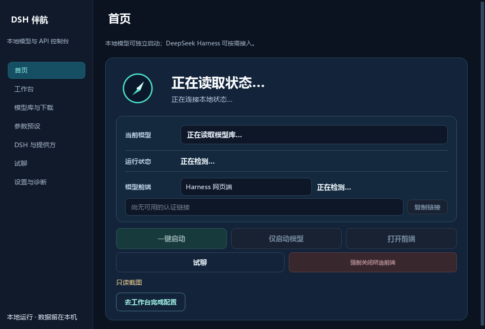

<div align="center">


# DSH Companion

**A local model & multi-frontend desktop console for DeepSeek Harness and Pi WebUI**

<p>
  <a href="./README.md">简体中文</a> &nbsp;|&nbsp; <strong>English</strong>
</p>

<p>
  <a href="https://github.com/toydream525/deepseek-harness-companion/releases/tag/v0.2.0"></a>
  
  <a href="./LICENSE"></a>
  <a href="https://yuriaqua.com/harness"></a>
</p>

<p>
  <a href="https://github.com/toydream525/deepseek-harness-companion/releases/download/v0.2.0/DSH-Companion-Setup-v0.2.0-windows-x64.exe"><strong>⬇️ Download Windows Installer</strong></a> &nbsp;·&nbsp;
  <a href="https://github.com/toydream525/deepseek-harness-companion/releases/download/v0.2.0/DSH-Companion-v0.2.0-windows-x64.zip">📦 Portable ZIP</a> &nbsp;·&nbsp;
  <a href="./docs/GETTING_STARTED.en.md">📖 Detailed Setup</a> &nbsp;·&nbsp;
  <a href="https://yuriaqua.com/harness">🌐 Project Site</a>
</p>

</div>

---

<div align="center">
  
</div>

> [!NOTE]
> **Independent Community Project:** DSH Companion is not affiliated with or endorsed by DeepSeek. Start a GGUF local API independently, test answers in Trial Chat, and manage DSH providers whenever needed. Pi WebUI is the community project [xing-shuyin/pi-web-ui](https://github.com/xing-shuyin/pi-web-ui); Harness Desktop is the standalone official app from [DeepSeek Harness](https://github.com/deepseek-ai/deepseek-harness).

---

## ✨ What It Does

| Feature | In the App |
| :--- | :--- |
| **🧠 Local Models** | Add GGUF files, select presets, start / stop, and monitor readiness status |
| **💬 Trial Chat** | Verify real model answers and inspect effective runtime parameters |
| **🔌 Harness Providers & APIs** | Detect or connect DSH; add, edit, or delete local and cloud providers, configure API URLs, protocols & model lists, securely save keys, and set the default model for future new sessions |
| **📦 Portable Settings** | One-click import / export of presets and setup bundles with missing-file rebinding |

---

## 🚀 Start in Three Steps

1. **Install the App** — Run the Windows installer above; for the portable version, fully extract the ZIP before launching `DSH-Companion.exe`.
2. **Prepare Components & a Model** — Download an engine for your hardware from [official llama.cpp releases](https://github.com/ggml-org/llama.cpp/releases), select `llama-server.exe` in the app, and register a GGUF file downloaded from Hugging Face. If using DSH, also install [Node.js](https://nodejs.org/en/download) and [DeepSeek Harness](https://github.com/deepseek-ai/deepseek-harness).
3. **Start & Verify** — Start the local model from the home screen and verify a real answer in Trial Chat. DSH, Pi WebUI, and Harness Desktop are optional and managed independently.

> See the [📖 full getting started guide](docs/GETTING_STARTED.en.md), or hand the [🤖 AI setup task](docs/AI_SETUP.en.md) to an AI assistant to configure step by step.

---

## 🤖 Ask an AI to Configure It

Pass the task below together with the [detailed setup guide](docs/GETTING_STARTED.en.md) to an AI assistant that can operate your computer. Download model weights manually from the Hugging Face links below; the assistant will reuse existing files and verify each step.

<details>
<summary><strong>Expand and copy the complete AI setup prompt</strong></summary>

```text
Actually configure the current stable or installed DSH Companion version on this Windows computer; do not only give me a tutorial. Check the app's actual version and follow its matching docs/GETTING_STARTED.en.md and resources/guides/从零配置指南.md. Inspect the OS, CPU/GPU, drivers, RAM/VRAM, and existing llama.cpp, GGUF, chat template, Node.js, and DSH files. Reuse working resources instead of downloading duplicates or deleting old models. Ask me to download the chosen GGUF manually from its Hugging Face page linked in the README; check its completeness and bind it in the app. Obtain other missing components only from official sources in the guide. Select engine and settings for this hardware rather than copying the RTX 4080 reference values. Verify engine detection, model registration, optional Qwen setup import and path rebinding, local API startup, and a real trial-chat answer. If I want DSH, also verify authenticated connection, local provider registration, new-session default, and a real new conversation. Give a concrete failure reason and retry action for any failed stage. Do not read, print, or upload keys, DSH authentication links, chat history, or personal configuration; ask me to enter credentials in the app. Finish with completed/incomplete steps, chosen file names, versions and paths, and decisions still needed from me. Do not enable advanced experimental presets by default.
```

</details>

> For a staged verification checklist and troubleshooting steps, see the [expanded AI setup task](docs/AI_SETUP.en.md).

---

## ⚙️ Optional: Qwen 16GB VRAM Recommended Reference Presets

Use **Import original prompt setup** inside the app, or choose a launcher in `scripts/deploy/`. Download only the GGUF for your chosen mode; pinned templates and parameters are listed in the [detailed guide](docs/GETTING_STARTED.en.md#qwen-reference-setup).

1. Pick a mode below, **manually download its complete GGUF** from Hugging Face, and prepare a compatible `llama.cpp` engine plus the template named in the guide (reuse existing files where available).
2. Add the model under **Model Library & Downloads**, then click **Import original prompt setup** in Workbench and bind your local model and template paths in the preview.
3. Select the bound preset, start the model, and verify a real answer in Trial Chat. To use DSH, connect the local provider and test a new conversation.

| Preset | Model Type | Reasoning | Best For | Main Tradeoff | Model Download |
| :--- | :--- | :---: | :--- | :--- | :--- |
| **[Thinking 32K](scripts/deploy/Uncensored32K.cmd)** | Huihui abliterated variant | On | Complex code, analysis, multi-step tasks | Usually longer wait | [Huihui IQ3_S](https://huggingface.co/huihui-ai/Huihui-Qwen3.8-27B-abliterated-GGUF/tree/main) |
| **[Fast 32K (Direct)](scripts/deploy/UncensoredDirect32K.cmd)** | Huihui abliterated variant | Off | Everyday questions, rewriting | Switch to Thinking for complex tasks | [Huihui IQ3_S](https://huggingface.co/huihui-ai/Huihui-Qwen3.8-27B-abliterated-GGUF/tree/main) |
| **[Original 32K](scripts/deploy/Original32K.cmd)** | Original Qwen (not abliterated) | On | General tasks needing original behavior | Follows original response policy more closely | [ISTA IQ3_S](https://huggingface.co/ISTA-DASLab/Qwen3.8-27B-GSQ-RCO-GGUF/tree/main) |
| **[Writing 8K](scripts/deploy/Writing8K-unverified.cmd)** | Huihui abliterated variant | On | Writing, rewriting | Larger IQ4 file; 8K context | [Huihui UD-IQ4_XS](https://huggingface.co/huihui-ai/Huihui-Qwen3.8-27B-abliterated-GGUF/tree/main) |

> <sub>32K / 8K refer to context length. Abliterated does not imply zero refusals or higher accuracy. Reference hardware: NVIDIA 16GB VRAM & 64GB RAM; adjust for other hardware using the <a href="docs/GETTING_STARTED.en.md#qwen-reference-setup">detailed guide</a>.</sub>

---

## 📚 Documentation

| Goal | Open |
| :--- | :--- |
| Install and use the app | [Getting started and full setup](docs/GETTING_STARTED.en.md) |
| Qwen files, templates, and settings | [Reference setup details](docs/GETTING_STARTED.en.md#qwen-reference-setup) |
| Fix startup or connection problems | [Common problems](docs/GETTING_STARTED.en.md#common-problems) |
| Recreate the original Qwen deployment | [Built-in setup guide (Chinese)](resources/guides/从零配置指南.md) |
| Ask an AI to configure it | [AI setup task](docs/AI_SETUP.en.md) |
| Build and publish from source | [Open-source build guide](docs/OPEN_SOURCE_RELEASE.md) |
| Licenses and dependencies | [MIT License](LICENSE) · [Third-party notices](THIRD-PARTY-NOTICES.md) |

---

<div align="center">
  <sub>Independent Open-Source Project · <a href="LICENSE">MIT License</a> · <a href="https://yuriaqua.com/harness">YuriAqua</a></sub>
</div>
